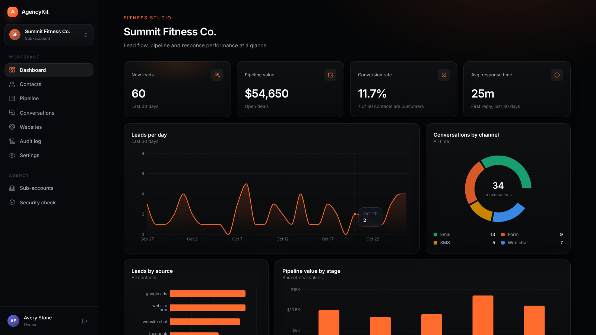
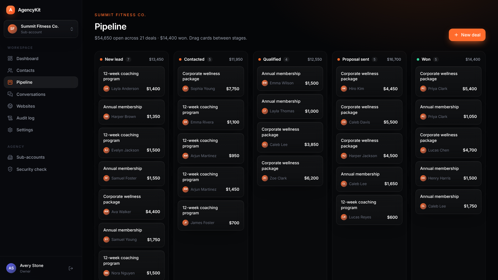
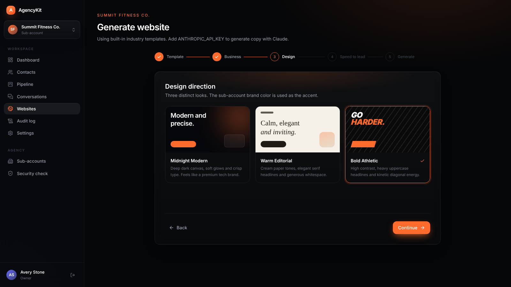
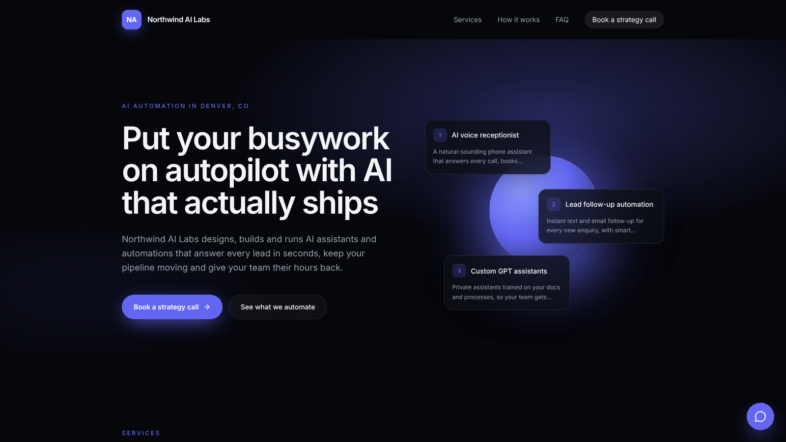
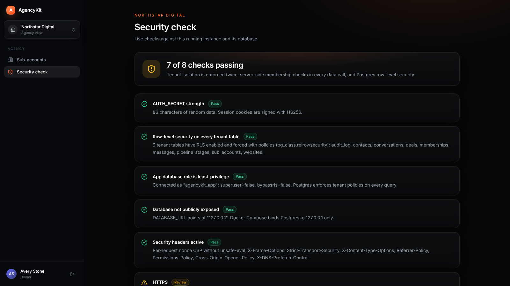

# AgencyKit

**A self-hosted, white-label agency platform.** Sign up as an agency, create a sub-account for every client, and give each one leads and contacts, a pipeline board, a conversations inbox, an AI-generated website with a contact form and chat widget, and an analytics dashboard.

Your server, your data, your brand. MIT licensed.



## Features

- **Agency and sub-accounts.** One agency, unlimited client sub-accounts, each with its own brand color, industry and team access (owner, admin, member).
- **Leads and contacts.** Searchable table with tags, stages, CSV import and CSV export.
- **Pipeline.** Drag-and-drop board with deal values per stage.
- **Conversations.** A unified inbox for website forms, web chat, email and SMS threads, with replies and response-time tracking.
- **AI websites.** A five-step wizard (template by industry, business details, design direction, speed-to-lead options, generate). With an `ANTHROPIC_API_KEY`, Claude writes the copy as structured JSON validated with zod. Without one, polished industry templates are used. Three distinct designs: Midnight Modern, Warm Editorial and Bold Athletic.
- **Speed to lead.** Every generated site can include a contact form (validated, honeypot, rate limited) and a floating AI chat widget that answers from the site's own content and captures name and email as a lead.
- **SEO built in.** Title, description, canonical URL, Open Graph, Twitter card, LocalBusiness JSON-LD and a per-site favicon.
- **Analytics.** New leads, pipeline value, conversion rate and response time, plus charts for leads per day, leads by source, pipeline by stage and conversations by channel.
- **Audit log and security check.** Every important action is recorded, and a live security page verifies secrets, row-level security, database role privileges and headers.

## Screenshots

| | |
|---|---|
|  |  |
|  |  |

<!-- Add more screenshots to docs/screenshots/ and reference them here. -->

## One-command install

Requirements: Docker with Compose v2, `openssl`, `git`.

```bash
git clone <your-fork-url> agency-kit && cd agency-kit
./scripts/setup.sh && docker compose up -d --build
```

Then open **http://localhost:3000**.

- `scripts/setup.sh` creates `.env` with random database passwords and a 64-byte `AUTH_SECRET` (mode 600). It refuses to overwrite an existing `.env`.
- On start, the app container applies database migrations and creates the **Northstar Digital** demo agency. The demo login is printed once:

```bash
docker compose logs app | grep -A3 "demo login"
```

Set `SEED_DEMO=false` in `.env` to skip the demo and create your own agency at `/signup` instead.

### Sample data

Sub-accounts start empty. To fill one with about 60 realistic leads over the last 30 days, deals across every stage and conversations:

```bash
docker compose exec app node scripts/seed-sample.mjs --sub <sub-account-slug>
# or, for local development:
npm run seed:sample -- --sub <sub-account-slug>
```

## Local development

Requires Node.js 22+.

```bash
./scripts/setup.sh          # once
docker compose up -d db     # Postgres on 127.0.0.1:5433
npm ci
npm run db:migrate
npm run seed:demo           # optional
npm run dev
```

| Script | What it does |
|---|---|
| `npm run dev` | Next.js dev server |
| `npm run build` | Production build |
| `npm run lint` / `npm run typecheck` | ESLint and TypeScript |
| `npm run db:migrate` | Apply SQL migrations and provision the least-privilege app role |
| `npm run db:generate` | Generate a new migration from `src/db/schema.ts` |
| `npm run seed:demo` | Create the demo agency (password printed once) |
| `npm run seed:sample -- --sub <slug>` | Fill a sub-account with sample data |
| `npm run test:isolation` | Prove tenant A cannot read or change tenant B data |
| `npm run test:smoke` | End-to-end test against a running instance |

## Security model

Tenant isolation is enforced in **two independent layers**:

1. **Application layer.** Every tenant query runs through `withTenant()` (`src/lib/tenant.ts`), which verifies on the server that the signed-in user belongs to the agency and has access to the sub-account.
2. **Database layer.** Postgres row-level security is enabled and forced on every tenant table. The tenant id is pinned per transaction with `SET LOCAL` semantics, and the app connects as `agencykit_app`, a role that is not a superuser and cannot bypass RLS. Even a query with a missing `WHERE` clause only sees the active tenant.

`npm run test:isolation` runs 19 checks against the real app role, including cross-tenant reads, inserts, updates and deletes.

Also included: bcrypt (cost 12) passwords with a 12-character minimum, signed `httpOnly` session cookies, login rate limiting, zod validation on every input, a nonce-based Content Security Policy, HSTS and other security headers, honeypot and rate limits on public forms, hashed API keys, a non-root Docker image, and services bound to `127.0.0.1`. See [SECURITY.md](SECURITY.md) for details and how to report a vulnerability.

## Configuration

All settings live in `.env` (see `.env.example`).

| Variable | Default | Purpose |
|---|---|---|
| `ANTHROPIC_API_KEY` | empty | Optional. Enables Claude for website copy and the chat widget. |
| `CLAUDE_MODEL` | `claude-opus-5-5` | Claude model id used for generation and chat. |
| `APP_URL` | `http://localhost:3000` | Public base URL, used for canonical links. Use https in production. |
| `SEED_DEMO` | `true` | Create the demo agency on first start. |
| `ALLOW_SIGNUP` | `false` | Keep public signup open after the first agency exists. |
| `COOKIE_SECURE` | `true` | Set to `false` only when serving over plain http on a non-localhost host. |
| `APP_PORT` / `DB_PORT` | `3000` / `5433` | Host ports, bound to 127.0.0.1. |
| `AUTH_SECRET`, `POSTGRES_PASSWORD`, `APP_DB_PASSWORD` | generated | Created by `scripts/setup.sh`. Never commit them. |

## Tech stack

Next.js 16 (App Router, server actions), React 19, TypeScript, Tailwind CSS 4, Drizzle ORM with `postgres`, PostgreSQL 16, zod 4, jose, bcryptjs, Recharts and the Anthropic SDK.

## License

[MIT](LICENSE) © 2026 Sas Mohanty
